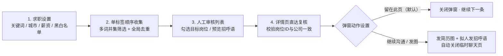

<div align="center">


# BossPilot

**BOSS 直聘 AI 实习与校招投递副驾**

多关键词宽召回筛选 · 硬性条件精准拦截 · 先审后投 · 详情页秒直达 · 拟人防风控沟通

[](manifest.json)
[](manifest.json)
[](src/greeting.js)
[](LICENSE)

[核心功能](#-核心功能) · [工作流程](#-工作流程) · [快速安装](#-30-秒快速安装) · [节奏与防风控](#-三档防风控节奏) · [常见问题](#-常见问题)

</div>

---

## ✨ 为什么选择 BossPilot

在 BOSS 直聘找实习或校招时，每天都在重复：**切关键词 → 翻几十页 → 辨别假实习/外包/低薪 → 点进详情 → 发招呼语 → 传简历图**。

**BossPilot** 作为浏览器原生侧边栏工作台，把重复劳动全部自动化，同时保留**人工最终审核权**与**拟人防风控节奏**：

| 能力维度 | BossPilot 如何帮你提效 |
| :--- | :--- |
| 🎯 **多关键词智能收集** | 一次配置最多 10 个关键词，单标签页顺序浏览，**并集匹配 + 按岗位 ID 全局去重**，自动动态顺延缺口与断点续翻 |
| 🛡️ **硬性条件精准拦截** | 支持**实习 / 校招**双模式，覆盖公司黑/白名单、一键排除常见大厂、城市/地区、通勤距离、薪资区间（含加密字体还原） |
| ⚡ **详情页直达秒投** | 审核后的岗位投递时直达 `/job_detail/<id>.html`，**免回搜索页重新翻页找卡片**，秒级定位且不受榜单刷新影响 |
| 🧠 **AI 原文证据招呼语** | 接入 DeepSeek 结合 JD 与简历生成定制招呼语，**严格逐字引用简历原文**，杜绝 AI 编造经历，并自动过滤手机号等隐私 |
| 🖼️ **简历图片 + 弹窗托管** | 支持弹窗自动点「留在此页」（极致防风控）或「继续沟通」自动传简历图 + 分段打字发送招呼语，投完自动关临时页 |
| 🎛️ **可视化审核与控制** | 侧边栏展示岗位、公司、薪资、筛选理由与原帖链接，支持**预览招呼语、只读检查入口、暂停 / 继续 / 停止 / 重置** |

---

## 🔄 工作流程



---

## 🚀 核心功能

### 1. 实习 & 校招双模式精准过滤
- **实习模式**：自动附加 BOSS 实习筛选，核对标题含「实习」并排除「非实习 / 仅限有实习经验 / 社招 / 兼职」等冲突岗位。
- **校招就业模式**：自动识别校招 / 应届标签与标题，拦截实习、社招与兼职岗位。
- **智能方向宽召回**：针对 `AI / Agent / 大模型 / 后端 / 全栈` 等热门方向结合岗位卡片 `tags` 联合匹配，自动拦截产品、运营、销售、标注、硬件、前端等非目标岗位。
- **全维度硬性门槛**：
  - **公司过滤**：自定义公司黑名单、白名单，支持一键「排除常见大厂」。
  - **地点与通勤**：目标城市、允许城区（如 `海淀、朝阳`）、最远通勤距离（公里）。
  - **薪资区间**：支持 `元/月`、`元/天`、`元/年`、`元/小时`，自动还原 BOSS 加密薪资字体；薪资面议、单位不符或低于下限自动跳过。

### 2. 多关键词无冲突调度
- 所有关键词共享一个全局去重池（按岗位 ID 去重），同一岗位命中多个词时自动合并标签，绝不重复投递。
- 某关键词触底后，剩余目标数自动顺延给后续关键词，减少无意义的反复切换页面。

### 3. 两种沟通方式自由切换
- **方式 A · 留在此页（推荐，极致防风控）**：触发「立即沟通」发送 BOSS 默认招呼后自动点击弹窗「留在此页」，不频繁跳转聊天页。
- **方式 B · 继续沟通（定制追发）**：自动进入网页聊天页，二次核验目标岗位与公司无误后，依次发送**简历图片**与 **AI 定制 / 固定招呼语**，完成后自动关闭新开的聊天标签页（0 标签残留）。

### 4. 三档防风控节奏

| 节奏档位 | 岗位间投递间隔 | 阅读 JD 停顿 | 分段自动休息 | 适用场景 |
| :--- | :---: | :---: | :---: | :--- |
| **高效快速** | `2 – 4s` | `0.5 – 1.0s` | 每 20 个休 `8 – 12s` | 批量快速沟通、高效率海投 |
| **均衡自然**（默认） | `3.5 – 6.5s` | `0.8 – 1.5s` | 每 15 个休 `12 – 18s` | 日常主力投递，速度与安全兼顾 |
| **稳健防风控** | `6 – 11s` | `1.2 – 2.2s` | 每 12 个休 `18 – 26s` | 深度定制沟通、大批量投递 |

> 内置**人机验证自动急停**：一旦页面出现安全验证或滑块弹窗，立即停止当前批次并将验证页切到前台，交由你手动处理。

---

## 📦 30 秒快速安装

> 纯原生浏览器扩展，无需 Node.js、无需编译打包，解压即用。

1. **下载项目**
   ```bash
   git clone https://github.com/kingofbuilding/BossPilot.git
   ```
   或直接点击右上角绿色 **`Code` → `Download ZIP`** 并解压到本地文件夹。
2. **加载到浏览器**
   - Chrome 打开 `chrome://extensions`，Edge 打开 `edge://extensions`。
   - 打开右上角 **开发者模式**。
   - 点击 **加载已解压的扩展程序**，选择解压后的 `BossPilot` 文件夹（包含 `manifest.json` 的目录）。
3. **开始使用**
   - 打开并手动登录 [BOSS 直聘](https://www.zhipin.com/)。
   - 点击浏览器工具栏的 **BossPilot** 图标，即可在右侧打开工作台侧边栏。

---

## 📖 使用指南

1. **求职设置**：在侧边栏切换到「求职设置」，填写关键词（最多 10 个，换行或逗号分隔）、城市、目标数量、操作节奏及硬性限制，点击 **保存配置**。
2. **收集与筛选**：切回「工作台」，选择 **实习** 或 **校招就业**，点击 **开始收集并筛选**。
3. **人工审核**：在审核列表中浏览匹配岗位，可取消不想投递的条目，也可点 **预览招呼语** 或 **检查沟通入口**（只读核验、不触发沟通）。
4. **一键投递**：点击底部 **投递选中的 N 个岗位**，全程实时日志追踪，随时可点 **暂停 / 继续 / 停止 / 重置**。

---

## ❓ 常见问题

<details>
<summary><b>1. 不填 DeepSeek API Key 可以用吗？</b></summary>
<br />
完全可以。仅收集筛选时不需要任何 API Key；投递时可选择「固定招呼语」或「留在此页」模式，全程免费零配置。
</details>

<details>
<summary><b>2. AI 招呼语会胡编我没做过的项目吗？</b></summary>
<br />
不会。BossPilot 要求模型仅从你的简历原文中抽取一条最相关的真实片段，并在本地严格校验该片段必须逐字存在于简历中，同时自动拦截手机号、邮箱、证件号等隐私；若未匹配到可靠片段，会自动回退为礼貌通用招呼语。
</details>

<details>
<summary><b>3. 已经收集保存好的岗位，过一段时间再投需要重新收集吗？</b></summary>
<br />
不需要。每个已审核岗位都保存了独立的详情页直达链接，再次投递时会直接打开对应岗位详情页并实时核验公司与岗位是否一致，秒级直达，无需重新翻搜索页。
</details>

<details>
<summary><b>4. 为什么有些岗位会被跳过？</b></summary>
<br />
已成功投递的岗位会自动去重；此外，若岗位在投递前复核不满足硬性限制、仅支持 App 沟通、或网页详情与审核记录不一致，都会安全跳过并在运行日志中写明原因。
</details>

---

## 🔒 隐私与声明

- **本地存储**：所有求职配置、审核列表、投递记录与简历图片均保存在当前浏览器的 `chrome.storage.local`，无任何第三方后台服务器。
- **AI 调用**：仅在你启用「AI 招呼语」并触发预览或投递时，将简历文字与当前岗位信息直接请求至你配置的 DeepSeek API。
- **合规使用**：本工具仅用于个人提升求职效率与技术学习交流，请合理设置投递节奏并遵守招聘平台的使用规范。
